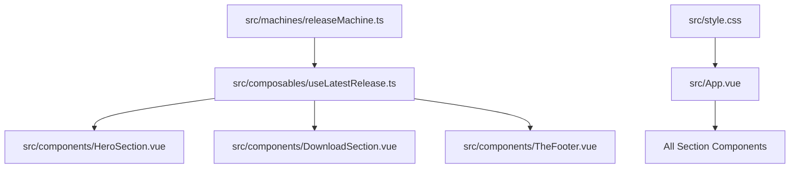

# Blast Radius & Impact Assessment — Big DockLocker Marketing Website

**Date:** 2026-11-06 | **Scope:** Shared Modules & Core Architecture

## 1. Shared Module Dependency Graph

## 2. Impact Analysis by Module

### `src/machines/releaseMachine.ts`

- **Dependents**: `src/composables/useLatestRelease.ts`, `tests/unit/releaseMachine.test.ts`
- **Blast Radius**: High (governs all dynamic release states and asset URL resolutions).
- **Test Coverage**: 12 dedicated unit tests covering 100% of state transitions and reconciliation.
- **Safety Gate**: Any change to `releaseMachine` requires full unit suite run (`npm run test`) and contract regression check.

### `src/composables/useLatestRelease.ts`

- **Dependents**: `HeroSection.vue`, `DownloadSection.vue`, `TheFooter.vue`, `tests/unit/useLatestRelease.test.ts`
- **Blast Radius**: High (singleton consumer of release machine; handles network timeouts and visibility events).
- **Test Coverage**: 18 unit tests with fake timers, network aborts, and event listeners.

### `src/style.css`

- **Dependents**: Global layout and all component styles.
- **Blast Radius**: Medium (visual tokens, section containers, and responsive breakpoints).
- **Safety Gate**: Verified via Playwright E2E smoke suite against Vite preview server.
